## ⚡ About Me

- 🎓 Electrical engineering student & builder
- 🔋 Currently building **VOLTREAD** — a smart piezoelectric energy harvester: floor tiles that turn footsteps into electricity, monitored live from an ESP32 → MQTT → Supabase → web dashboard pipeline — **[voltread.vercel.app](https://voltread.vercel.app)**
- 🌐 I also build for the web — the **Energius** site series and small web experiments live on this account
- 🌱 Exploring **computer vision**, **bioinformatics**, and **biomedical signal processing**
- 🛠️ I like projects where hardware and software meet — sensors, firmware, and the dashboards that make their data useful

## 🧰 Tech Stack

### 💻 Languages

### 🔌 Embedded & IoT

### 🌐 Web & Backend

### 📊 Data, Vision & Science

### 🛠️ Tools & Platforms

## 🚀 Featured Projects

| Project | What it is |
|---|---|
| ⚡ **[VOLTREAD](https://voltread.vercel.app)** | Piezoelectric smart energy harvester — EVA pedestrian tiles, ESP32 + INA219 telemetry over MQTT, live monitoring dashboard |
| 🌐 **[Energius](https://github.com/LlvallVeiz/Energius)** | Web project series — energy-themed website builds & iterations |
| 🎮 **[Chronicles-of-Aethel](https://github.com/LlvallVeiz/Chronicles-of-Aethel)** | A web game experiment |
| 🦅 **[Garuda](https://github.com/LlvallVeiz/Garuda)** | Web build |
| 🏠 **[llvallveiz.github.io](https://github.com/LlvallVeiz/llvallveiz.github.io)** | My GitHub Pages site |

## 📊 GitHub Stats

## 🐉 Contribution Dragon

<picture>
  <source media="(prefers-color-scheme: dark)" srcset="https://raw.githubusercontent.com/LlvallVeiz/LlvallVeiz/output/github-contribution-grid-dragon-dark.svg">
  
</picture>

---

<i>“Every Step Powers Tomorrow.”</i>

